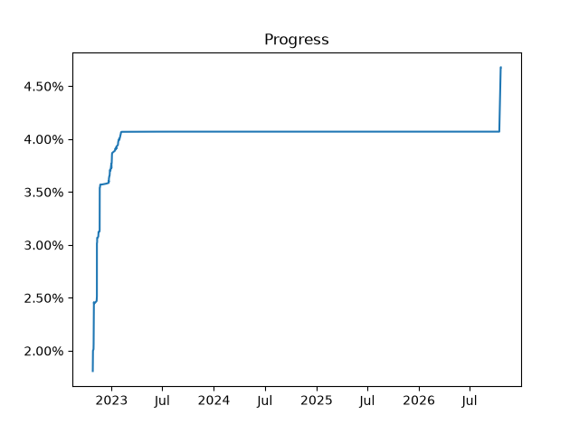

# SM3DLandDecomp

Fork of [3dsdecomp/RedPepper](https://github.com/3dsdecomp/RedPepper), a
decompilation of the EU version of Super Mario 3D Land (retail JP, KO, TW and
US versions are nearly identical). This fork continues the upstream work with a
headless, independently verified rebuild pipeline around the original compiler.
The upstream README content is kept further below.

## Fork status

- Target: EU `code.bin` (title `0004000000053F00`, 3,096,576 bytes, SHA-256
  `e1d7e188ff88467df776c17cec45c44857fadf5b699944baa8cddcae7d939e64`). The game
  binary, its extraction and every analysis output stay local (`code.bin`,
  `Build/` and `.local/` are ignored); the repository only records addresses,
  sizes and hashes derived from it.
- Whole-source partial image, raw four-byte-word match against the stock
  `code.bin`: **4.6787%** (144,880 / 3,096,576 bytes) at the October 19, 2026
  checkpoint, versus the inherited upstream figure of 4.0704% kept unchanged in
  `Data/Code.json`. This metric counts equal words across the entire image,
  including data and padding; it is not function coverage, and the image still
  contains explicit stubs, so it is not a playable rebuild.
- Every routine counted as recovered is compiled from source with the original
  compiler and compared byte for byte at its original EU address. Rank `O` rows
  in `Symbols/**/*.sym` and `Data/RecoveredFunctions.json` record them;
  provisional bodies stay `NON_MATCHING` with rank `M`/`m`.
- `BACKGROUND.md` is the authoritative log: methods, compiler and linker rules
  learned along the way, the SHA-256 of every checkpoint manifest and the next
  bounded batches.

### Building the fork's units

The header and SDK changes needed by the recovered source are kept as
cumulative patches against the clean submodule heads:

```sh
git submodule update --init --recursive
git -C Library/RedPepper-Headers apply ../../Tools/patches/RedPepper-Headers-placement-args.patch
git -C Library/nnsdk apply ../../Tools/patches/nnsdk-collision-normalize.patch
```

Then, with the original `code.bin` placed at the repository root and the
compiler bootstrapped by `Tools/bootstrap_armcc.py` into `.local/`:

```sh
.local/venv/bin/python Tools/headless.py status
.local/venv/bin/python Tools/headless.py verify
.local/venv/bin/python Tools/whole_build.py --prepare-only
.local/venv/bin/python Tools/whole_runtime_build.py
.local/venv/bin/python Tools/verify_image.py --elf <Build/whole-runtime/ID/RedPepper.elf> --binary code.bin --out <report.json>
```

`Tools/matching.py --source <unit> --out <report>` checks individual units
against their original bytes.

## Tools used so far

| Purpose | Tool |
| --- | --- |
| Original compiler | ARM RealView `armcc` 4.1 build 791 for game, `al`, sead and LibMessageStudio units and 4.0 build 902 for SDK units, run headlessly on macOS through [wibo](https://github.com/decompals/wibo) 1.2.0; downloads and extracted files are hash-pinned by `Tools/bootstrap_armcc.py` |
| Linking and inspection | GNU `arm-none-eabi` binutils 2.26 (`ld` for analysis and whole-image links, `objdump`), plus the upstream [asm-differ](https://github.com/simonlindholm/asm-differ) submodule |
| Static analysis | Ghidra 12.1.3 headless (`Tools/ExportAnalysis.java`, `Tools/ImportSymbols.java`, `Tools/ReviewNerveRegistration.java`); the export lives under `.local/analysis` and is never committed |
| Verification | Python 3 virtual environment with capstone 5, unicorn 2 and pyelftools: `Tools/matching.py`, `Tools/verify_elf.py`, `Tools/verify_image.py`, `Tools/whole_build.py`, `Tools/whole_runtime_build.py`, `Tools/branch_nop.py`, `Tools/inline_arm_leaf.py`, the `Tools/*_behavior.py` emulation harnesses and the `Tools/tests` suite run by `Tools/headless.py verify` |
| Original linker | Keil MDK 4.22 `armlink` is present but unlicensed (L9932E), so all links use GNU `ld`; armlink-specific behaviour (branch-to-NOP, `--inline` leaf copies) is reproduced by documented passes |

## Models used so far

The recovery in this fork was done in [Cursor](https://cursor.com) agent
sessions; the October 19, 2026 sessions recorded in `BACKGROUND.md` ran on
Anthropic's Claude Fable 5.1. The model proposed source, header layouts and
tooling; every match claim comes from the pinned compiler and the independent
byte comparisons above, never from the model.

---

# RedPepper (upstream README)

This is a decompilation of the EU version of Super Mario 3D Land. (note that retail JP, KO, TW, and US versions are nearly identical)

## Progress

 

 



Visit [the Wiki](https://al.littun.co/decomp) for instructions on how to build and contribute to this project.

## Links

- [Discord Server](https://discord.gg/wK4ZKa9QXq)
- [Wiki](https://al.littun.co/decomp)
- [decomp.me](https://decomp.me/)

## Credits
- [open-ead/sead](https://github.com/open-ead/sead)
